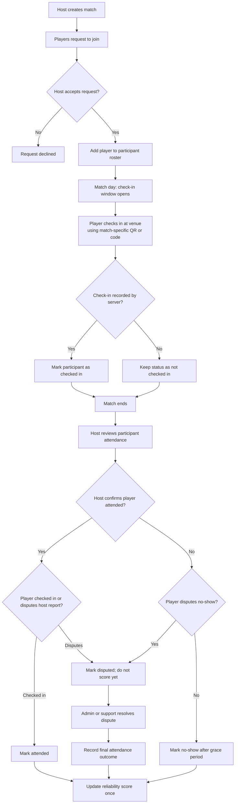

# Match attendance flow

## When to confirm attendance

- **When a player joins:** After the host accepts, add them to the participant list. This means reserved, not attended.
- **At the venue:** Open check-in shortly before the match and close it after a defined grace period. A match-specific QR code or code can record check-in.
- **After the match:** Have the host confirm attendance for the roster and allow players to dispute an incorrect report.
- **After confirmation or dispute resolution:** Record the final outcome and update the reliability score once. A missing QR scan alone should not automatically count as a no-show.

## Implementation notes

The current match data is mock/local-storage based in `../context/MatchContext.tsx`, with sample matches in `../data/games.mock.ts`. The server does not yet have match or attendance storage, so attendance needs server-side match and participant records before it can be trusted.

A participant record could store `userId`, status (`requested`, `accepted`, `checked_in`, `attended`, `no_show`, or `disputed`), check-in time, and who confirmed the final outcome. The server should derive the player’s identity from their authenticated session rather than trusting a client-supplied user ID.
